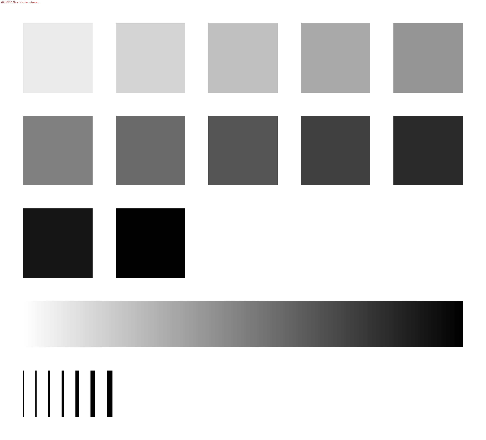
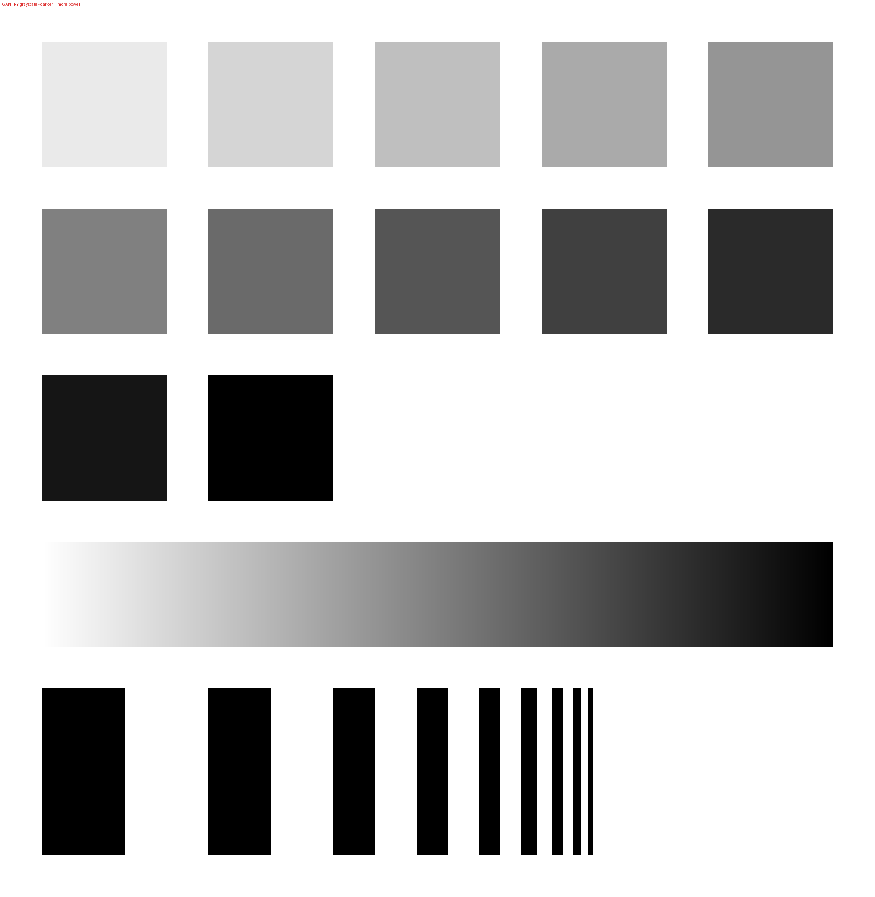

# Lasering ⚡

A personal collection of tips, tricks, and tools for laser fabrication. Think of
it as my little workshop notebook: part experimentation, part calibration, and
part figuring out how to make a very focused beam of light do what I want.

The collection starts with a couple of calibration coupons for LightBurn
relief work. More discoveries can find their way here as the experiments
continue!

## On the workbench

- **[Calibration coupon generator](calib_coupons.py):** Make custom test
  patterns and measurement logs.
- **[Galvo coupon](coupon_galvo_3dsliced.png):** For LightBurn's 3D Sliced
  mode, with depth steps, a smooth ramp, and fine-feature lines. Intended for
  galvo machines such as MOPA, Q-switched, and UV lasers.
- **[Gantry coupon](coupon_gantry_grayscale.png):** For variable-power
  grayscale engraving, with power steps, a ramp, and edge-response bars.
  Intended for CO₂, diode, and 1064 nm gantry lasers.
- **Measurement logs:** Use the [galvo log](log_galvo.csv) or
  [gantry log](log_gantry.csv) to record your material, settings, and measured
  depths. Because "that one setting worked great" is much more useful when you
  actually wrote it down.

## A peek at the patterns

| Galvo / 3D Sliced | Gantry / grayscale |
| :---: | :---: |
|  |  |

These are **previews for looking, not lasering**. Use the coupon PNGs linked
above for engraving: they're 16-bit grayscale images with embedded DPI metadata
to help LightBurn import them at the intended size. Always check the dimensions
and your settings before running a test.

In the image scale, darker means a greater target depth for 3D Sliced or more
power for grayscale. White is the zero end of the scale; black is the maximum.
The actual result depends on your material, machine, and settings.

## Make your own coupons

You'll need Python 3, NumPy, and Pillow. From the repository directory, in an
activated Python 3 virtual environment:

```sh
python -m pip install numpy Pillow
mkdir my-coupons
cd my-coupons
python ../calib_coupons.py
```

The script makes both coupons, both previews, and both CSV logs in the **current
directory**. It overwrites files with the same names, including any logs you've
filled in, so use a fresh output folder or save copies before running it again.

Want to change things up? From `my-coupons`, use these options instead of the
default command:

```sh
python ../calib_coupons.py --steps 12 --pad 6 --gap 2 --dpi 1000
```

| Option | What it changes | Default |
| --- | --- | --- |
| `--steps` | Number of test pads | `10` |
| `--pad` | Side length of each square pad, in mm | `5` |
| `--gap` | Gap between features, in mm | `2` |
| `--dpi` | Image resolution | `1000` |

Import the appropriate coupon into LightBurn, select the matching image mode,
and try it on a suitable scrap of material. Record your settings and
measurements in the corresponding CSV, adjust, and repeat. Tiny experiments,
better results!

## A quick safety note

Know your material before you zap it. Use an appropriate enclosure,
extraction, and wavelength-rated eye protection, follow your machine's safety
guidance, and never leave a running laser unattended.

Happy lasering, and may your focus always be sharp. ✨
